# Tahadhari

**El Niño flood alerts for Kenya, built with Kotlin Multiplatform.**

Kenya is facing a very strong El Niño during the October–December 2026 short rains. Official
forecasts exist, but they are often technical, national-level and in English. Tahadhari turns open
rainfall and river forecasts into simple, county-level flood risk alerts in **English and Swahili**,
with clear advice on what to do.

- **Android**: pick your county, see the 7-day rainfall outlook, flood risk and what to do.
- **Desktop dashboard**: see all 47 counties ranked by risk, for county disaster teams and responders.
- **Web**: the same dashboard in a browser, with nothing to install:
  **[stmakori.github.io/tahadhari](https://stmakori.github.io/tahadhari/)** (add `?mobile` for the phone layout).

**▶️ [Watch the demo video](https://drive.google.com/file/d/1-t9035zLP8boXLHMrrV-gsa-zdlV_GF1/view?usp=sharing)**: the main features on Android, desktop and web.

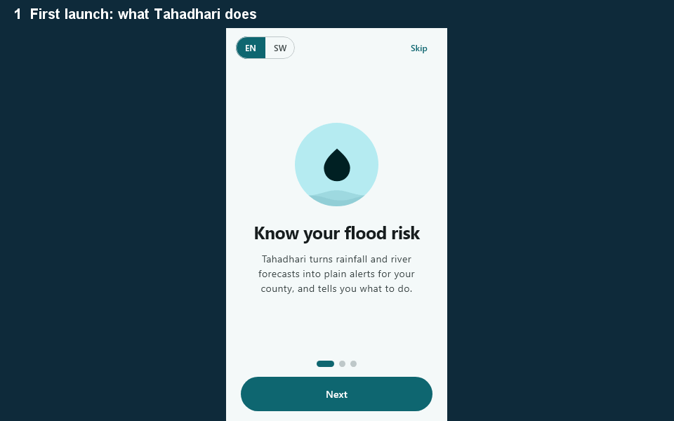

## Features

**Android app (residents)**
- County picker with search, or "Use my location" (coarse location, asked only when tapped; you
  confirm the suggested county). The app remembers your county and language.
- Risk card with the level shown by colour, shape and words; 7-day rain chart with threshold lines;
  river outlook; plain-language explanation; a checklist of what to do.
- Works offline: the last forecast is saved and shown with "Updated …" or a "Showing saved
  forecast" warning. Saved data older than 3 days is never used to show a risk level.
- **Safety** tab: offline guides for floods, landslides, cholera and safe water, livestock and
  farms, lightning and flash floods, with sources.
- **Emergency** tab: tap-to-dial 999, 112 and 1199 (Kenya Red Cross), your county's known hotspots,
  and "I'm safe" / "I need help" messages shared through any app.
- **Share this alert**: a short WhatsApp/SMS-ready summary (level, main reason, top actions,
  emergency numbers) for family groups, built from the offline text, never the AI's.
- **Read aloud**: speaks the level, a short explanation and what to do (offline template text, under a
  minute). Android uses the phone's text-to-speech (Swahili if a voice is installed, otherwise English
  with a note); desktop uses the OS voice (Windows PowerShell, macOS `say`, Linux `espeak-ng`) and the
  web uses the browser's speech synthesis. The button is hidden where no speech is available.
- **Forecast for your exact location** (optional, Android): on a county screen, switch from the county
  town's forecast to your own point. Coordinates are rounded to about 1 km before the request, are not
  saved, and the option is refused if you are outside Kenya or over 100 km from that county's town.
- **Home-screen widget** with your county's risk, refreshed every 3 hours (shows "No data" rather
  than Low when the forecast can't be loaded).
- Optional **notification when your county rises to High or Severe** (off by default, once per
  rise, never from saved or failed data).
- **Counties I watch**: follow up to 3 other counties (for family elsewhere) under your own county on
  the Alerts screen. Each row shows the level, the main reason and when it was updated, or a
  retry (never a level) when it can't load. Tap a row for its full forecast. With risk notifications
  on, watched counties notify too (once per rise per county, never from saved or failed data).
  Watched counties are fetched together in 1 rainfall call plus at most 1 river call, on refresh.
- Crash reports stay on the phone in a local file; you choose whether to share one.
- First-launch intro, an **About / How it works** page (risk thresholds, data sources, privacy),
  and pull-to-refresh.
- English and Swahili throughout, light and dark themes, screen-reader labels, and layouts tested
  at 1.5× text size.

**Desktop dashboard (county teams, Red Cross, NGOs)**
- Kenya county map coloured by risk (hover for details, click to select). Counties without data
  are hatched and labelled "No data", never shown as Low.
- Summary chips per level that filter a ranked list (wettest day, 3-day total, river rise).
- **Trend since yesterday**: an arrow and "was Moderate" on counties whose level changed, and a "Rising (n)" chip.
  Compared with the last snapshot from an earlier day (Nairobi time); only fresh, fully loaded data is saved.
  The CSV gets a `change_since_yesterday` column and the briefing lists the rising counties.
- Side-by-side county detail, overall "last updated" time, EN/SW toggle, About dialog.
- Refreshes automatically every 3 hours, keeping the current data on screen while it reloads.
- **Export CSV** of all 47 counties, or a printable **HTML briefing** (counts, ranked table, and
  what to do in High and Severe counties) for morning briefings.
  [Sample briefing](docs/briefing-sample.html).
- Remembers language, selected county and filter between runs.

## Screenshots

| Dashboard | Dashboard (Swahili, filtered to High) |
|---|---|
| 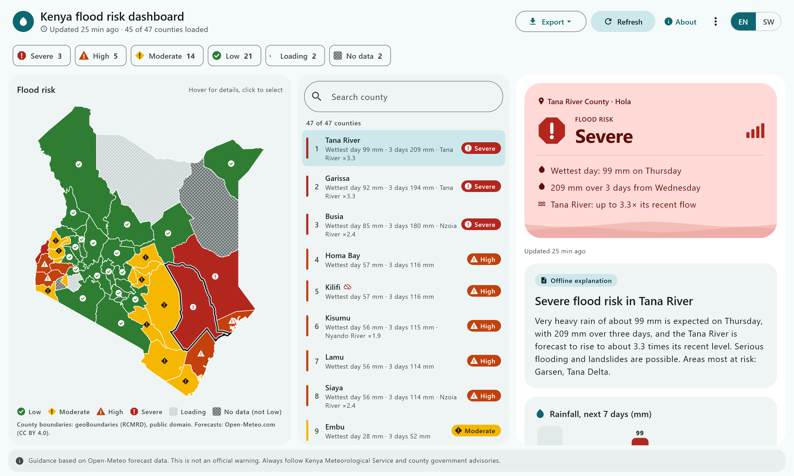 | 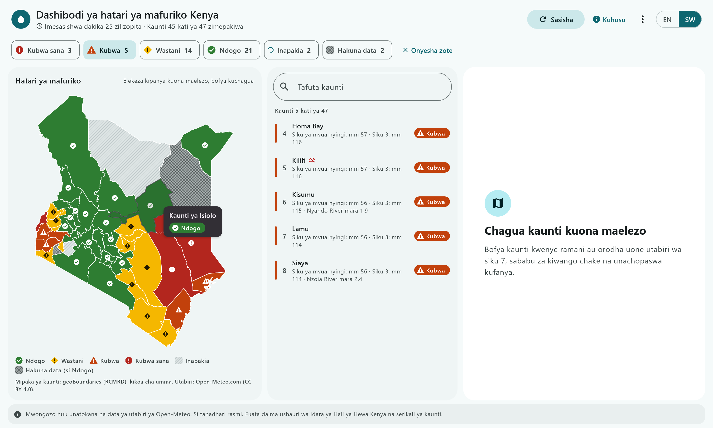 |

| County detail | Swahili, dark | Safety guide | Emergency |
|---|---|---|---|
| 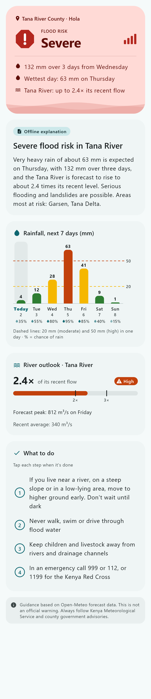 | 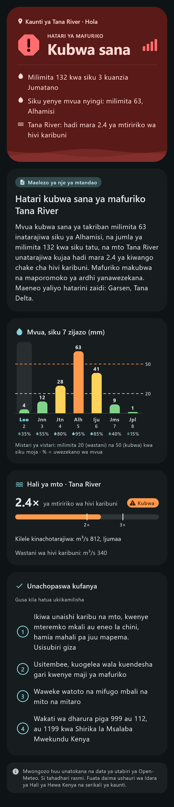 | 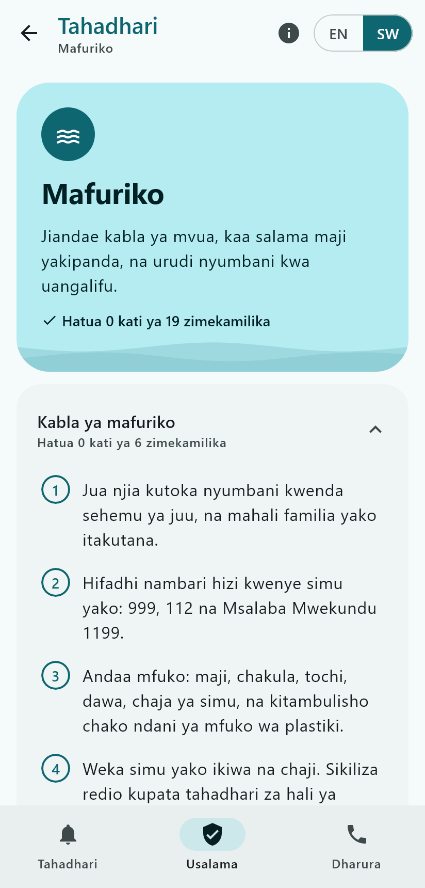 | 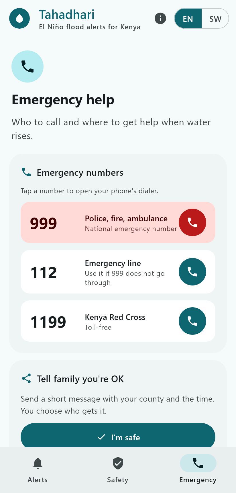 |

| County picker | Location | About | Intro |
|---|---|---|---|
| 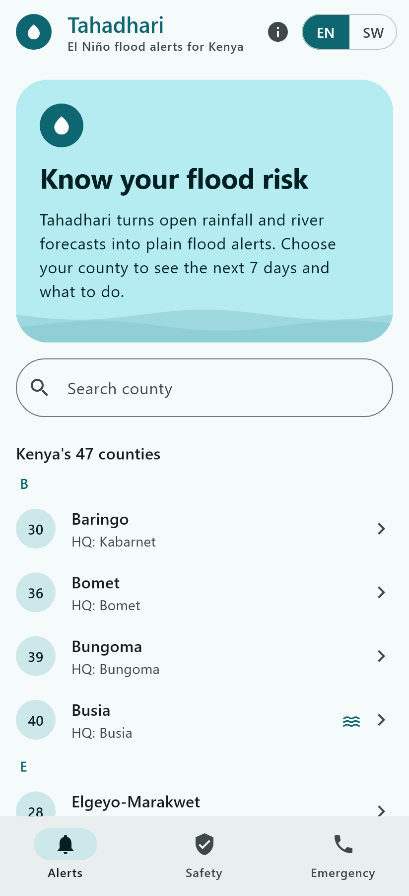 | 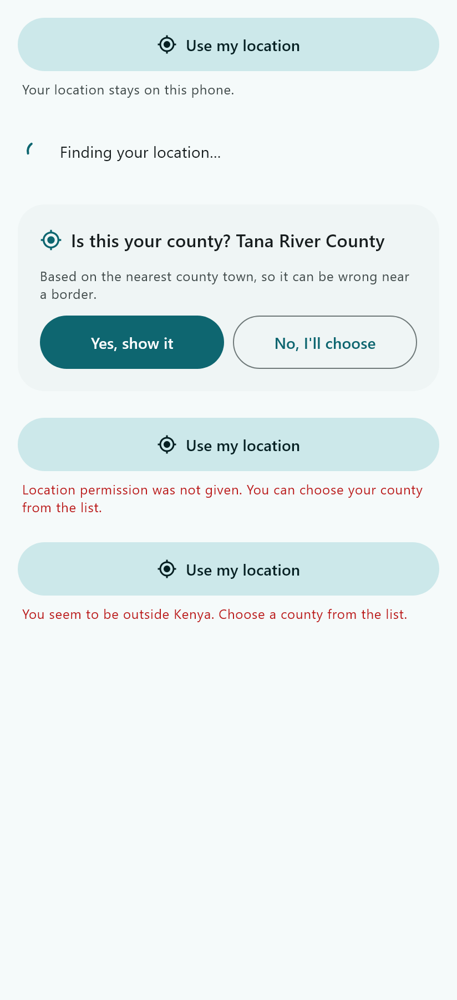 | 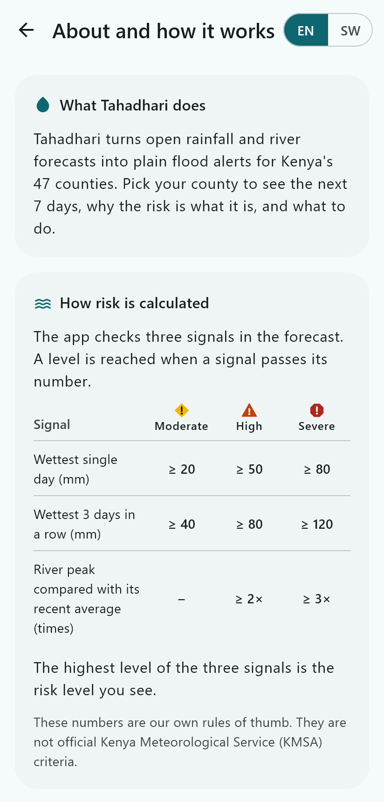 | 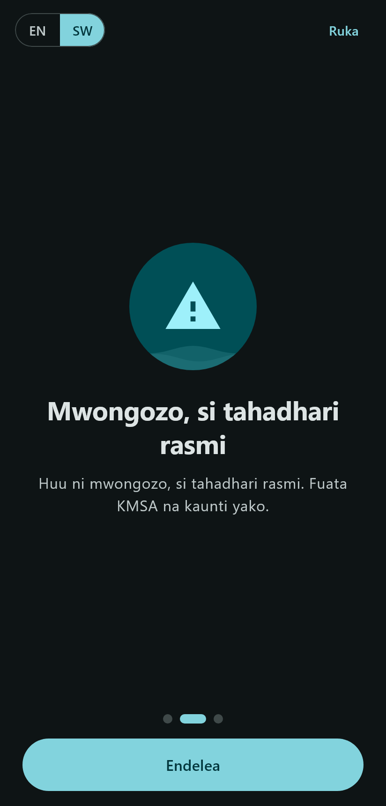 |

Screenshots are rendered from sample data by `TAHADHARI_SCREENSHOTS=1 ./gradlew :composeApp:desktopTest`.

> ⚠️ Tahadhari provides guidance based on forecast data. It is **not an official warning**.
> Always follow the Kenya Meteorological Service and your county government.

## Architecture: one codebase, four targets

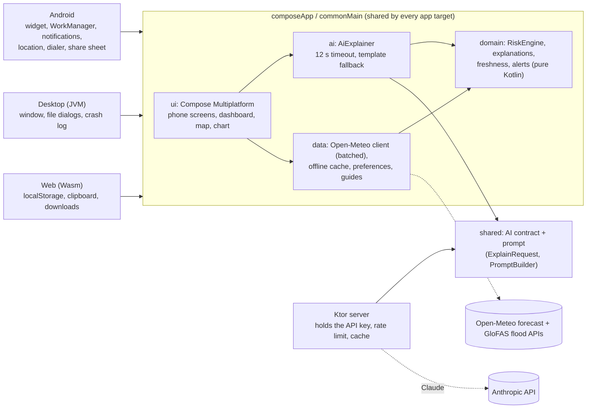

How much of each app is shared code (non-blank Kotlin lines, excluding generated map data):

| Target | Shared (`commonMain`) | Platform-specific | Platform code is… |
|---|---|---|---|
| Android | **92%** | 582 lines | widget, background refresh, notifications, location, dialer, share sheet |
| Desktop | **98%** | 162 lines | window, native save dialog, file store, crash log |
| Web | **99%** | 85 lines | `localStorage`, clipboard, file download |

The app and the Ktor server also share the AI contract and prompt in the `shared` module, so the
request the app sends and the reply the server checks can't drift apart. `domain` is pure Kotlin,
with no Compose, Ktor or platform code. It is covered by the `commonTest` unit tests, which run on
every target.

## Run it

Requirements: JDK 17+, Android Studio (Ladybug or newer) with the Kotlin Multiplatform plugin,
or just the JDK for the desktop app.

Set `JAVA_HOME` to your JDK before running Gradle. On Windows, open a new terminal after installing
the JDK so it picks up the variable.

```bash
./gradlew :composeApp:run                        # desktop dashboard
./gradlew :composeApp:run --args="--mobile"      # phone layout in a desktop window (quick preview)
./gradlew :composeApp:installDebug               # Android (device or emulator connected)
./gradlew :composeApp:assembleDebug              # APK in composeApp/build/outputs/apk/debug/
./gradlew :composeApp:allTests :shared:jvmTest :server:test   # all tests
./gradlew :composeApp:packageDistributionForCurrentOS          # desktop installer (MSI/DMG/DEB)
./gradlew :composeApp:wasmJsBrowserDevelopmentRun              # web dashboard in your browser
./gradlew :composeApp:wasmJsBrowserDistribution                # static web build for hosting
```

**Web version.** The dashboard also runs in the browser (Kotlin/Wasm; needs a recent Chrome,
Firefox, Edge or Safari). Add `?mobile` to the URL for the phone layout. On the web, explanations
use AI only when the page was built with a server URL (the published site is; a local build shows
the offline text), and numbers are copied to the clipboard instead of dialled.
`.github/workflows/pages.yml` publishes it to GitHub Pages on every push to `main`. In the repo
settings, set **Pages → Source** to **GitHub Actions**.

### Try the key features

1. **Dashboard**: run the desktop app, wait for the 47 counties to load, click a "High" or
   "Severe" chip, hover over the map, click a county, then use **Export → Export briefing** and
   open the file in a browser.
2. **Offline mode**: open a county, turn off your network and press refresh. The saved forecast is
   shown with a warning, never an error that looks like "Low".
3. **Phone flow**: on Android (or with `--args="--mobile"`), pick a county, switch to **SW**, open
   **Safety → Floods**, then **Emergency → I'm safe** to share a check-in message.
4. **Read aloud and your location**: on a county screen press **Read aloud** (press again to stop; on
   desktop it needs Windows, macOS or `espeak-ng`). On Android press **Use my exact location**, then
   **Back to ... HQ forecast** to switch back.
5. **Widget**: on Android, choose a county in the app, then long-press the home screen →
   Widgets → Tahadhari.
6. **Counties I watch**: on the Alerts screen scroll to **Counties I watch**, press **Add a county**,
   pick one, then tap its row to open the forecast and press Back to return. Turn off your network
   and pull to refresh to see saved data with its date; remove a county with the **x** on its row.
7. **Screenshots** of every screen with sample data (no network needed):
   `TAHADHARI_SCREENSHOTS=1 ./gradlew :composeApp:desktopTest`, output in `composeApp/build/screenshots/`.

### Release builds

- `./gradlew :composeApp:assembleRelease` builds a minified APK (R8). To sign it, copy
  `keystore.properties.example` to `keystore.properties` (git-ignored) or set the
  `TAHADHARI_KEYSTORE_*` environment variables. Without them the APK is debug-signed, with a
  warning, and must not be published.
- CI (`.github/workflows/ci.yml`) runs every test and builds the APK and a Linux installer on each
  push, and runs an Android emulator smoke test (picks a county, opens each tab, and checks "Low" is
  never shown with an error). Pushing a `v*` tag runs `release.yml`, which builds the APK, MSI, DMG
  and DEB and attaches them to a GitHub Release.
- [`docs/demo-script.md`](docs/demo-script.md) is a shot-by-shot script for the demo video.

## AI explanations (optional)

The app works fully offline with built-in English and Swahili explanations. With the AI server
reachable, it shows friendlier, county-specific explanations written by Claude, and falls back to
the offline text automatically if the server is slow or unavailable.

**Nothing to set up to try it.** The Android and desktop apps use the hosted server at
`https://tahadhari-ai.onrender.com` by default. It runs on a free plan that sleeps when idle, so the
first explanation after a quiet spell may be the offline text; refresh after a few seconds for the
AI version. The hosted server allows 20 AI requests per hour in total, to cap API spend; after that the app
shows the offline text until the hour is up.

To run your own server instead:

```bash
export ANTHROPIC_API_KEY=your-key       # never commit this
./gradlew :server:run                   # starts on http://localhost:8080
TAHADHARI_PROXY_URL=http://localhost:8080 ./gradlew :composeApp:run
```

For Android, add `tahadhari.proxyUrl=http://10.0.2.2:8080` to `local.properties` (the emulator's
address for your computer), or your own `https://` server for a real phone. Leave it blank
(`tahadhari.proxyUrl=`) to build without AI.

The server uses `claude-haiku-5-5` by default (override with `TAHADHARI_MODEL`).

**Web build.** The browser version uses AI only when a server URL is configured, otherwise it shows
the offline text. Two settings are needed:

- On the server, set `TAHADHARI_ALLOWED_ORIGINS` to the full origin of the web app, for example
  `https://stmakori.github.io` (comma-separate several). The default allows only the local dev server
  (`http://localhost:8080`, `http://127.0.0.1:8080`). Only `POST /v1/explain` with the
  `Content-Type` header is allowed, without credentials.
- In the web page, set `<meta name="tahadhari-proxy-url" content="https://your-server">` in
  `composeApp/src/wasmJsMain/resources/index.html`. Blank means no AI. Only `https://` URLs are
  accepted (plus `http://localhost` and `http://127.0.0.1` for development). The GitHub Pages
  workflow fills this tag from the repository variable `TAHADHARI_PROXY_URL` (Settings, Secrets
  and variables, Actions, Variables); leave it unset for offline text.

The AI only receives forecast facts calculated by the app. It never decides the risk level.

### Official advisories

KMD has no public API for its weekly county forecasts, so advisories are bundled in
`composeApp/src/commonMain/kotlin/ke/tahadhari/data/BundledAdvisories.kt`. Each entry is copied word
for word from a `.go.ke` page, with its validity dates and link. While an advisory is valid, the
county screen shows an **Official advisory** card with the text and a button to the source. The AI
also gets the text, as data inside `<advisory>` tags, so it can mention it. Expired advisories are
ignored automatically and never change the risk level. `AdvisoriesTest` checks every entry (https
`.go.ke` link, dates, length, county codes). The file's header comment explains how to add one.

### Deploy the AI server

The `Dockerfile` at the repository root builds only the server, without the Android SDK, and runs it
on `PORT` (default 8080). It works on any container host (Google Cloud Run, Render, Railway,
Fly.io). CI builds the image and checks `/health` on every push.

**Render (used for the hosted server):** `render.yaml` is a Blueprint. In the Render dashboard choose
**New > Blueprint**, pick this repository and paste your Anthropic key when asked for
`ANTHROPIC_API_KEY`. Render builds the Dockerfile, serves it over HTTPS at
`https://tahadhari-ai.onrender.com` (or similar) and redeploys on every push to `main`. The free plan
sleeps after 15 minutes without traffic; the first request after that takes longer than the app's
12-second timeout, so it shows the offline explanation once and the AI text on the next refresh.

Or on Google Cloud Run:

```bash
gcloud run deploy tahadhari-ai --source . --region europe-west1 --allow-unauthenticated \
  --set-secrets ANTHROPIC_API_KEY=anthropic-api-key:latest \
  --set-env-vars TAHADHARI_TRUSTED_PROXY_HOPS=1,TAHADHARI_ALLOWED_ORIGINS=https://stmakori.github.io
```

| Variable | Default | Purpose |
|---|---|---|
| `ANTHROPIC_API_KEY` | (required) | Store it as a secret on the host, never in the image or the repo |
| `TAHADHARI_MODEL` | `claude-haiku-5-5` | Model id |
| `ANTHROPIC_AWS_WORKSPACE_ID` | (unset) | Set it (`wrkspc_...`) to use [Claude Platform on AWS](https://platform.claude.com/docs/en/build-with-claude/claude-platform-on-aws) instead of the Claude API. Then `ANTHROPIC_API_KEY` (or `ANTHROPIC_AWS_API_KEY`) holds the API key from the AWS console |
| `AWS_REGION` | (unset) | Region of that workspace, for example `us-west-2`; required with `ANTHROPIC_AWS_WORKSPACE_ID` |
| `TAHADHARI_REQUESTS_PER_HOUR` | 60 | Per caller address |
| `TAHADHARI_TRUSTED_PROXY_HOPS` | 0 | Load balancers in front of the server that append to `X-Forwarded-For`. Most hosts have one, so set it to `1` (check your host's docs). With `0` behind a load balancer, all users share one rate limit |
| `TAHADHARI_ALLOWED_ORIGINS` | local dev server | Web build origins (see above) |

Then put the HTTPS URL in `local.properties` (`tahadhari.proxyUrl=https://...`) before building the
APK, in `TAHADHARI_PROXY_URL` for desktop, and in the `TAHADHARI_PROXY_URL` repository variable for
the web build. Also set a monthly spend limit on the API key in the Anthropic Console.

### Example outputs

[`docs/ai-examples.md`](docs/ai-examples.md) shows real explanations for 12 counties in English and
Swahili: the exact facts the AI got, its reply, and a check for numbers that were not in the facts.
Regenerate it with a running server:

```bash
TAHADHARI_AI_EXAMPLES=1 ./gradlew :composeApp:desktopTest --tests "ke.tahadhari.AiExamplesTest"
```

## How risk is calculated

Each county gets the highest level triggered by any of these signals (heuristic thresholds, not
official KMSA criteria):

| Signal | Moderate | High | Severe |
|---|---|---|---|
| Wettest single day | ≥ 20 mm | ≥ 50 mm | ≥ 80 mm |
| Wettest 3-day window | ≥ 40 mm | ≥ 80 mm | ≥ 120 mm |
| River forecast peak vs 30-day baseline | – | ≥ 2× | ≥ 3× |
| Landslide: wettest 3-day window, in landslide-prone counties only | – | ≥ 50 mm | ≥ 100 mm |

The river signal is ignored where the recent flow is under 5 m³/s, because a forecast grid cell that
misses the channel gives meaningless ratios. Landslide-prone counties (Murang'a, West Pokot,
Elgeyo-Marakwet, Nandi, Kericho, Taita-Taveta, Nyeri, Bungoma, Kiambu) are marked only where a
reported landslide or a susceptibility study backs it; sources are in `Counties.kt`.

**Saturated ground (available, off by default; the back-test did not support it, see `docs/validation.md` section 8).** Floods come from rain on ground that is already soaked, so the app also reads
soil moisture (9-27 cm, Open-Meteo `soil_moisture_9_to_27cm`, in the same request as rainfall). If it
is at or above `RiskThresholds.soilSaturatedM3m3` and the rainfall-based level is already at least Moderate, the level goes up one step,
capped at High. It never raises Low, never creates Severe, never lowers a level, and missing soil data
changes nothing. The threshold is `null` in the shipped app, so users never see this reason.

**Upstream rain (available, off by default; the back-test did not support it, see `docs/validation.md` section 9).** Garissa and Tana River flood from rain
in the Mt Kenya and Aberdare catchment, and Busia and Siaya from the Nzoia catchment. When `RiskThresholds.upstreamRainFloor` is set and an upstream county's
rainfall-only level (heavy day or wet spell) reaches `upstreamTriggerLevel` (High), the downstream county is at least that floor. It never lowers a level; if the upstream rain
cannot be loaded, the local level stays and the explanation says upstream rain was not checked. Upstream rain costs at most one extra batched request on the phone and none on the dashboard.
The back-test found the river signal already on for those counties, so the shipped value is `null`.

**Chance of heavy rain (information only).** The county detail also shows how many of the 51 ECMWF
ensemble runs have a day over 50 mm this week, for the county you are viewing only. It never changes
the risk level, and is hidden while loading or if the request fails.

### How well does it work?

[`docs/validation.md`](docs/validation.md) replays the March–May 2024 floods (about 290 deaths by
mid-May) through the real `RiskEngine`, using archived ECMWF and GFS forecasts and ERA5 observed
rainfall. It reports misses and false alarms as plainly as hits:

- **Rainfall alone is a weak detector at county scale.** With the shipped thresholds, even perfectly
  observed rain never reached High for the five rain-driven events, and the ECMWF forecast reached
  at most Moderate for any of them. The rain at a county's grid point was far below what fell at the flood sites.
- **The river signal is the only thing that caught the Tana River and Garissa floods**, after the
  river points were moved from dry grid cells to cells that carry the river (about 600 m³/s mean) and a
  5 m³/s floor was added. Re-run: High or higher in 2 of 7 events for ECMWF and perfect rain, 4 of 7 for
  GFS, against about 1.1 to 1.7 expected by chance. But that signal is on about a third of all days in
  the season at those points, so it is a hindcast with seven events, not proof of skill.
- **High or Severe covers 7.5 % of county-days (ECMWF)**, up from 4.0 % before the river fix and the
  landslide signal. Almost all of those fall outside the documented events (an upper bound on false alarms).
- **Lowering the thresholds roughly doubled false alarms** for little gain, so they were not changed. A proposed
  "saturated ground" (soil moisture) rule caught more events only by turning Moderate into High on
  about a fifth of all days, so it is evaluated in the report and left off.

That is why every screen says Tahadhari is guidance, not an official warning. Re-run it with
`TAHADHARI_BACKTEST=1 ./gradlew :composeApp:desktopTest --tests "ke.tahadhari.BacktestRunnerTest"`.

## Data sources

- Weather and river discharge data from [Open-Meteo](https://open-meteo.com/) (forecast API and
  flood API, based on GloFAS), licensed under CC BY 4.0. Soil moisture comes from the same forecast API.
- Chance of heavy rain: [Open-Meteo Ensemble API](https://open-meteo.com/en/docs/ensemble-api), ECMWF
  IFS ensemble (`ecmwf_ifs025`, 51 members). Open-Meteo data is CC BY 4.0 and ECMWF open data is
  CC BY 4.0, so credit both: "Weather data by Open-Meteo.com; ECMWF IFS ensemble, CC BY 4.0".
- County boundaries from [geoBoundaries](https://www.geoboundaries.org/) gbOpen KEN ADM1 (source:
  RCMRD), public domain. Runfola et al. (2020), *geoBoundaries: A global database of political
  administrative boundaries*, PLoS ONE 15(4): e0231866. Simplified with
  `tools/geo/build_county_shapes.py`.
- Official forecast link: the county detail screen opens the Kenya Meteorological Department's county
  forecast index, <https://meteo.go.ke/our-products/county-forecasts/> (checked 2026-10-28, HTTP 200).
  Per-county pages exist but their addresses contain that week's dates, so only the index is linked.
  Also checked: `/our-products/daily-forecast/`, `/5-day-forecast/`, `/monthly-forecast/` and
  `/weather-warnings/`. KMD has no public API; the app only opens the page, it does not read it.
- Official advisories (when bundled): copied word for word from KMD or county government `.go.ke`
  pages, shown with their issuer, validity and a link to the source (see "Official advisories").
- Safety guide content is based on Kenya Red Cross, Kenya Ministry of Health, WHO, USGS and US
  National Weather Service guidance. Each guide lists its sources in the app.

## License

MIT — see [LICENSE](LICENSE).
