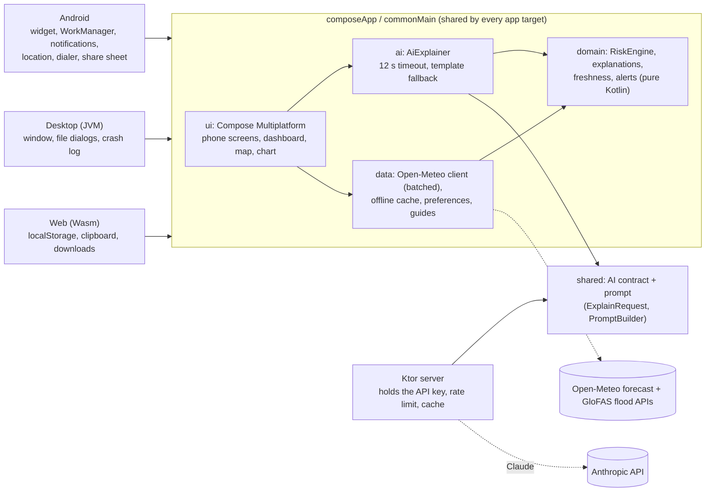

# Tahadhari

**El Niño flood alerts for Kenya, built with Kotlin Multiplatform.**

Kenya is facing a very strong El Niño during the October–December 2026 short rains. Official
forecasts exist, but they are often technical, national-level and in English. Tahadhari turns open
rainfall and river forecasts into simple, county-level flood risk alerts in **English and Swahili**,
with clear advice on what to do.

- **Android**: pick your county, see the 7-day rainfall outlook, flood risk and what to do.
- **Desktop dashboard**: see all 47 counties ranked by risk, for county disaster teams and responders.
- **Web**: the same dashboard in a browser, with nothing to install.


## Features

**Android app (residents)**
- County picker with search, or "Use my location" (coarse location, asked only when tapped; you
  confirm the suggested county). The app remembers your county and language.
- Risk card with the level shown by colour, shape and words; 7-day rain chart with threshold lines;
  river outlook; plain-language explanation; a checklist of what to do.
- Works offline: the last forecast is saved and shown with "Updated …" or a "Showing saved
  forecast" warning. Saved data older than 3 days is never used to show a risk level.
- **Safety** tab: offline guides for floods, landslides, cholera and safe water, livestock and
  farms, lightning and flash floods, with sources.
- **Emergency** tab: tap-to-dial 999, 112 and 1199 (Kenya Red Cross), your county's known hotspots,
  and "I'm safe" / "I need help" messages shared through any app.
- **Share this alert**: a short WhatsApp/SMS-ready summary (level, main reason, top actions,
  emergency numbers) for family groups, built from the offline text, never the AI's.
- **Read aloud**: speaks the level, a short explanation and what to do (offline template text, under a
  minute). Android uses the phone's text-to-speech (Swahili if a voice is installed, otherwise English
  with a note); desktop uses the OS voice (Windows PowerShell, macOS `say`, Linux `espeak-ng`) and the
  web uses the browser's speech synthesis. The button is hidden where no speech is available.
- **Forecast for your exact location** (optional, Android): on a county screen, switch from the county
  town's forecast to your own point. Coordinates are rounded to about 1 km before the request, are not
  saved, and the option is refused if you are outside Kenya or over 100 km from that county's town.
- **Home-screen widget** with your county's risk, refreshed every 3 hours (shows "No data" rather
  than Low when the forecast can't be loaded).
- Optional **notification when your county rises to High or Severe** (off by default, once per
  rise, never from saved or failed data).
- Crash reports stay on the phone in a local file; you choose whether to share one.
- First-launch intro, an **About / How it works** page (risk thresholds, data sources, privacy),
  and pull-to-refresh.
- English and Swahili throughout, light and dark themes, screen-reader labels, and layouts tested
  at 1.5× text size.

**Desktop dashboard (county teams, Red Cross, NGOs)**
- Kenya county map coloured by risk (hover for details, click to select). Counties without data
  are hatched and labelled "No data", never shown as Low.
- Summary chips per level that filter a ranked list (wettest day, 3-day total, river rise).
- **Trend since yesterday**: an arrow and "was Moderate" on counties whose level changed, and a "Rising (n)" chip.
  Compared with the last snapshot from an earlier day (Nairobi time); only fresh, fully loaded data is saved.
  The CSV gets a `change_since_yesterday` column and the briefing lists the rising counties.
- Side-by-side county detail, overall "last updated" time, EN/SW toggle, About dialog.
- Refreshes automatically every 3 hours, keeping the current data on screen while it reloads.
- **Export CSV** of all 47 counties, or a printable **HTML briefing** (counts, ranked table, and
  what to do in High and Severe counties) for morning briefings.
  [Sample briefing](docs/briefing-sample.html).
- Remembers language, selected county and filter between runs.

## Screenshots

| Dashboard | Dashboard (Swahili, filtered to High) |
|---|---|
|  |  |

| County detail | Swahili, dark | Safety guide | Emergency |
|---|---|---|---|
|  |  |  |  |

| County picker | Location | About | Intro |
|---|---|---|---|
|  |  |  |  |

Screenshots are rendered from sample data by `TAHADHARI_SCREENSHOTS=1 ./gradlew :composeApp:desktopTest`.

> ⚠️ Tahadhari provides guidance based on forecast data. It is **not an official warning**.
> Always follow the Kenya Meteorological Service and your county government.

## Architecture: one codebase, four targets



How much of each app is shared code (non-blank Kotlin lines, excluding generated map data):

| Target | Shared (`commonMain`) | Platform-specific | Platform code is… |
|---|---|---|---|
| Android | **92%** | 582 lines | widget, background refresh, notifications, location, dialer, share sheet |
| Desktop | **98%** | 162 lines | window, native save dialog, file store, crash log |
| Web | **99%** | 85 lines | `localStorage`, clipboard, file download |

The app and the Ktor server also share the AI contract and prompt in the `shared` module, so the
request the app sends and the reply the server checks can't drift apart. `domain` is pure Kotlin,
with no Compose, Ktor or platform code. It is covered by the `commonTest` unit tests, which run on
every target.

## Run it

Requirements: JDK 17+, Android Studio (Ladybug or newer) with the Kotlin Multiplatform plugin,
or just the JDK for the desktop app.

Set `JAVA_HOME` to your JDK before running Gradle. On Windows, open a new terminal after installing
the JDK so it picks up the variable.

```bash
./gradlew :composeApp:run                        # desktop dashboard
./gradlew :composeApp:run --args="--mobile"      # phone layout in a desktop window (quick preview)
./gradlew :composeApp:installDebug               # Android (device or emulator connected)
./gradlew :composeApp:assembleDebug              # APK in composeApp/build/outputs/apk/debug/
./gradlew :composeApp:allTests :shared:jvmTest :server:test   # all tests
./gradlew :composeApp:packageDistributionForCurrentOS          # desktop installer (MSI/DMG/DEB)
./gradlew :composeApp:wasmJsBrowserDevelopmentRun              # web dashboard in your browser
./gradlew :composeApp:wasmJsBrowserDistribution                # static web build for hosting
```

**Web version.** The dashboard also runs in the browser (Kotlin/Wasm; needs a recent Chrome,
Firefox, Edge or Safari). Add `?mobile` to the URL for the phone layout. On the web, explanations
use the offline text and numbers are copied to the clipboard instead of dialled.
`.github/workflows/pages.yml` publishes it to GitHub Pages on every push to `main`. In the repo
settings, set **Pages → Source** to **GitHub Actions**.

### Try the key features

1. **Dashboard**: run the desktop app, wait for the 47 counties to load, click a "High" or
   "Severe" chip, hover over the map, click a county, then use **Export → Export briefing** and
   open the file in a browser.
2. **Offline mode**: open a county, turn off your network and press refresh. The saved forecast is
   shown with a warning, never an error that looks like "Low".
3. **Phone flow**: on Android (or with `--args="--mobile"`), pick a county, switch to **SW**, open
   **Safety → Floods**, then **Emergency → I'm safe** to share a check-in message.
4. **Read aloud and your location**: on a county screen press **Read aloud** (press again to stop; on
   desktop it needs Windows, macOS or `espeak-ng`). On Android press **Use my exact location**, then
   **Back to ... HQ forecast** to switch back.
5. **Widget**: on Android, choose a county in the app, then long-press the home screen →
   Widgets → Tahadhari.
6. **Screenshots** of every screen with sample data (no network needed):
   `TAHADHARI_SCREENSHOTS=1 ./gradlew :composeApp:desktopTest`, output in `composeApp/build/screenshots/`.

### Release builds

- `./gradlew :composeApp:assembleRelease` builds a minified APK (R8). To sign it, copy
  `keystore.properties.example` to `keystore.properties` (git-ignored) or set the
  `TAHADHARI_KEYSTORE_*` environment variables. Without them the APK is debug-signed, with a
  warning, and must not be published.
- CI (`.github/workflows/ci.yml`) runs every test and builds the APK and a Linux installer on each
  push, and runs an Android emulator smoke test (picks a county, opens each tab, and checks "Low" is
  never shown with an error). Pushing a `v*` tag runs `release.yml`, which builds the APK, MSI, DMG
  and DEB and attaches them to a GitHub Release.
- [`docs/demo-script.md`](docs/demo-script.md) is a shot-by-shot script for the demo video.

## AI explanations (optional)

The app works fully offline with built-in English and Swahili explanations. With the AI server
running, it shows friendlier, county-specific explanations written by Claude, and falls back to
the offline text automatically if the server is slow or unavailable.

```bash
export ANTHROPIC_API_KEY=your-key       # never commit this
./gradlew :server:run                   # starts on http://localhost:8080
./gradlew :composeApp:run               # desktop picks up the server automatically
```

For Android, the emulator reaches your computer at `10.0.2.2`, which is the default. For a real
phone, deploy the server with HTTPS and add `tahadhari.proxyUrl=https://your-server` to
`local.properties`.

The server uses `claude-haiku-5-5` by default (override with `TAHADHARI_MODEL`).

**Web build.** The browser version uses AI only when a server URL is configured, otherwise it shows
the offline text. Two settings are needed:

- On the server, set `TAHADHARI_ALLOWED_ORIGINS` to the full origin of the web app, for example
  `https://user.github.io` (comma-separate several). The default allows only the local dev server
  (`http://localhost:8080`, `http://127.0.0.1:8080`). Only `POST /v1/explain` with the
  `Content-Type` header is allowed, without credentials.
- In the web page, set `<meta name="tahadhari-proxy-url" content="https://your-server">` in
  `composeApp/src/wasmJsMain/resources/index.html`. Blank means no AI. Only `https://` URLs are
  accepted (plus `http://localhost` and `http://127.0.0.1` for development). The GitHub Pages
  workflow fills this tag from the repository variable `TAHADHARI_PROXY_URL` (Settings, Secrets
  and variables, Actions, Variables); leave it unset for offline text.

The AI only receives forecast facts calculated by the app. It never decides the risk level.

## How risk is calculated

Each county gets the highest level triggered by any of these signals (heuristic thresholds, not
official KMSA criteria):

| Signal | Moderate | High | Severe |
|---|---|---|---|
| Wettest single day | ≥ 20 mm | ≥ 50 mm | ≥ 80 mm |
| Wettest 3-day window | ≥ 40 mm | ≥ 80 mm | ≥ 120 mm |
| River forecast peak vs 30-day baseline | – | ≥ 2× | ≥ 3× |
| Landslide: wettest 3-day window, in landslide-prone counties only | – | ≥ 50 mm | ≥ 100 mm |

The river signal is ignored where the recent flow is under 5 m³/s, because a forecast grid cell that
misses the channel gives meaningless ratios. Landslide-prone counties (Murang'a, West Pokot,
Elgeyo-Marakwet, Nandi, Kericho, Taita-Taveta, Nyeri, Bungoma, Kiambu) are marked only where a
reported landslide or a susceptibility study backs it; sources are in `Counties.kt`.

### How well does it work?

[`docs/validation.md`](docs/validation.md) replays the March–May 2024 floods (about 290 deaths by
mid-May) through the real `RiskEngine`, using archived ECMWF and GFS forecasts and ERA5 observed
rainfall. It reports misses and false alarms as plainly as hits:

- **Rainfall alone is a weak detector at county scale.** With the shipped thresholds the ECMWF
  forecast reached High in 0 of 7 documented events, and even perfectly observed rain reached
  High in 0 of 7. The rain at a county's grid point was far below what fell at the flood sites.
- **The river signal was the most promising**, but the Tana River and Garissa points were on dry
  grid cells. They have been moved to cells that carry the river (≈ 716 m³/s mean), and a 5 m³/s
  floor was added. On the right cells, the hindcast ratio was 4–8× in the days before the Garissa
  floods.
- **Lowering the thresholds roughly doubled false alarms** for little gain, so they were not changed.

That is why every screen says Tahadhari is guidance, not an official warning. Re-run it with
`TAHADHARI_BACKTEST=1 ./gradlew :composeApp:desktopTest --tests "ke.tahadhari.BacktestRunnerTest"`.

## Data sources

- Weather and river discharge data from [Open-Meteo](https://open-meteo.com/) (forecast API and
  flood API, based on GloFAS), licensed under CC BY 4.0.
- County boundaries from [geoBoundaries](https://www.geoboundaries.org/) gbOpen KEN ADM1 (source:
  RCMRD), public domain. Runfola et al. (2020), *geoBoundaries: A global database of political
  administrative boundaries*, PLoS ONE 15(4): e0231866. Simplified with
  `tools/geo/build_county_shapes.py`.
- Safety guide content is based on Kenya Red Cross, Kenya Ministry of Health, WHO, USGS and US
  National Weather Service guidance. Each guide lists its sources in the app.

## License

MIT — see [LICENSE](LICENSE).
