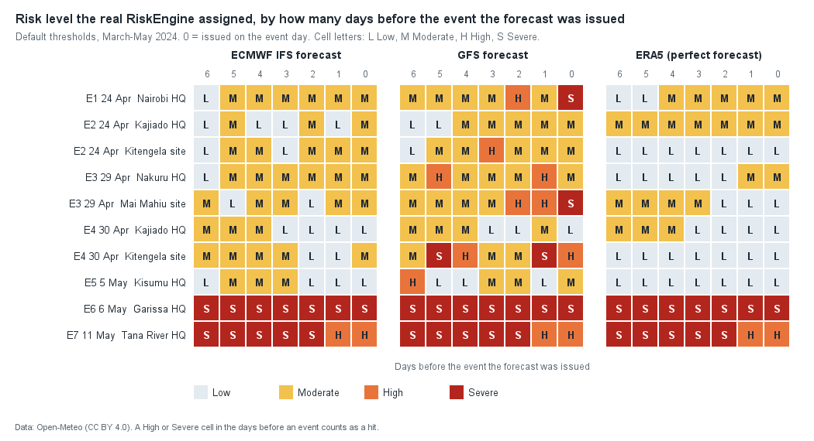
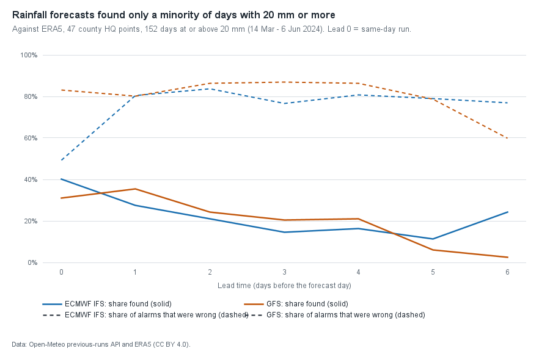
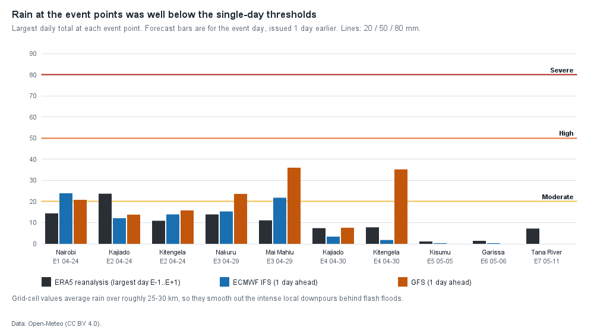
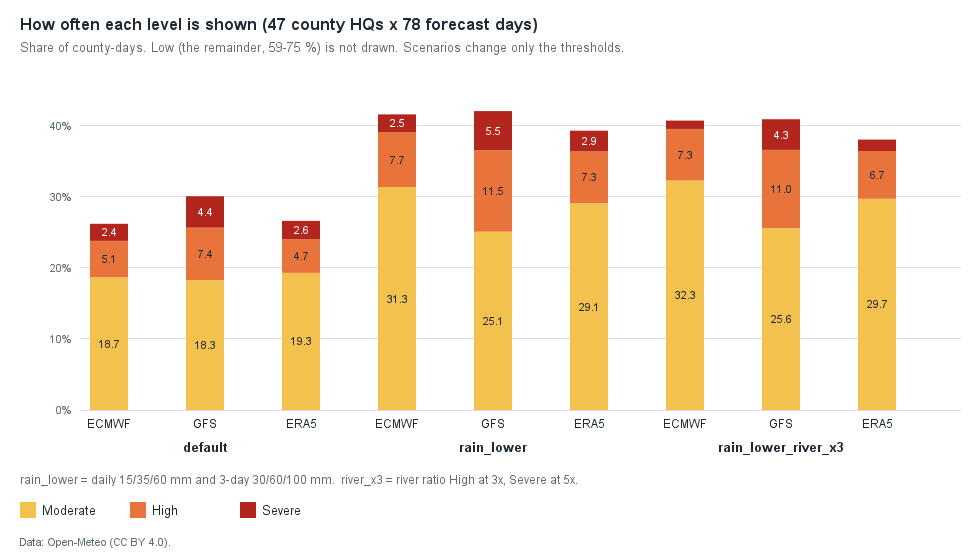

# Back-test: how would Tahadhari's risk levels have done in the March-May 2024 Kenya floods?

**Short answer.** On this one season, with free open forecast data, the app's risk levels are a weak
detector of the documented flood events. This page was first written with the river points on dry
grid cells; it has since been **re-run with the corrected river points and the 5 m3/s baseline floor**
(section 4 has the before/after). Now the ECMWF-based forecast reaches **High or higher in 2 of 7**
documented events (it was 0 of 7), GFS in 4 of 7 (was 3), and even perfect rain (ERA5) in 2 of 7 (was 0).
Both new hits are the Tana River and Garissa floods, found only through the **river signal**, which was
already High or Severe for about a month before and after those events (so it is not a sharp warning).
No rainfall-driven hit was added. The chance baseline rose too: 1.1 expected High+ hits for ECMWF
(was 0.9). The share of county-days at High or Severe rose from 4.0 % to 7.5 % (ECMWF), about a
third (+35 county-days) from the river fix and two thirds (+94) from the landslide signal added to the engine in between. Seven events,
one hindcast season: this is not evidence that the engine works, only that the river fix did what it was
meant to. Details, caveats and tuning ideas follow.

Nothing here changes the app. `RiskEngine` thresholds were **not** modified; the tuning ideas at the
end are suggestions only.

> **Re-run after the river-point fix (28 Oct 2026).** The Tana River, Garissa, Siaya and Kisumu river points
> were moved to GloFAS cells that carry the river (Tana -2.325, 40.175; Garissa -0.525, 39.575; Nzoia
> 0.125, 34.025; Nyando -0.175, 34.875) and `RiskEngine` ignores the river signal when the 30-day
> baseline is below 5 m3/s (`riverMinBaselineM3s`). The data was re-fetched for the current points
> (`fetch.py --river-only`), the back-test was re-run through the real engine, and every number below is
> the new one, with the earlier ("before") number kept where it helps. Note two things changed between the
> first run and this one: the river points, and the **landslide signal** (`landslideHighMm` 50 mm
> 3-day total, in 9 marked counties) that was added to `RiskEngine`. `analyze_rerun.py` separates the two.
> The first run is reproduced exactly by that script (147 / 309 / 177 High+ county-days), which checks the
> script as well.

## 1. What was tested

The back-test runs the app's real `RiskEngine` (and the real `RiverOutlook.fromSeries` and
`CountyForecast` types), not a re-implementation. For every one of the 47 county headquarters (the
same points the app uses) plus three event sites (Kitengela, Mai Mahiu, Budalang'i), and for every
"issue day" from 15 March to 31 May 2024 (78 days), it builds the 7-day forecast the app would have
seen that morning and records the level.

Three rainfall inputs are compared:

| Input | What it is | Honest description |
|---|---|---|
| **ECMWF IFS 0.25 deg forecast** | Archived model forecasts from Open-Meteo's Previous Runs API | A real forecast with real lead times (see below) |
| **GFS forecast** | Same API, NOAA GFS | A real forecast, wetter than ERA5 on average (mean 6.5 mm/day vs 4.4) |
| **ERA5 reanalysis** | Open-Meteo archive API | "If the forecast had been perfect" upper bound. It is itself a model estimate, not a gauge record |

### What "lead time" really means here

- For an issue day D, forecast day D+k is taken from the model run that was available **k days
  earlier** (Previous Runs API variables `precipitation_previous_dayK`, k = 0..6). So a day-3 value is a
  genuine 3-day-ahead forecast. Hours are summed into Nairobi (EAT) calendar days.
- This is an approximation of what the app saw: the app asks the live API on D and gets one
  consistent 7-day run, whereas here each day comes from a run issued at the same clock time k days
  earlier. Differences are small compared with the forecast errors reported below.
- **I first tried Open-Meteo's Historical Forecast API and the default `best_match` model, and
  rejected them.** The Historical Forecast API stitches the first hours of each model run into one
  series, so it is a short-lead forecast, not a "3 days ahead" one. Worse, for this period the numbers
  I checked (Nairobi, 22-25 April, and `best_match` day-0 at four points) were identical to ERA5 (for
  example 14.4 mm on 24 April), so they are not an independent forecast. That is why the two named
  models above are used. The live app uses `best_match`, whose make-up differs from these two; the
  results are a proxy for it, not the same thing.
- River discharge is a **hindcast**, not an as-issued forecast: the Flood API's historical series
  (GloFAS) is used for both the 30-day baseline (D-30..D-1) and the "forecast" peak (D..D+6). It therefore
  has perfect foresight of the river over the next 7 days and slightly flatters the river signal.

### Ground truth: documented impacts

A dated list of documented impacts, from the Kenya Red Cross, UN agencies, ACAPS and major news
outlets. Dates are the day the flooding was reported or began; several are approximate (reports lag
events, and rivers rise over days).

| ID | Event | County | Date used | Sources |
|---|---|---|---|---|
| E1 | Nairobi flash floods; bodies collected 25 Apr, Mathare, Kibera, Kayole worst hit | Nairobi | 24 Apr | [The Star](https://www.the-star.co.ke/news/2024-04-25-13-bodies-collected-after-heavy-rains-in-nairobi), [UN-Habitat](https://new.unhabitat.org/sites/default/files/2024/04/un-habitat_statement_on_the_nairobi_floods_26.04.2024.pdf) |
| E2 | Athi River bursts its banks, two deaths, road to Nairobi cut | Kajiado (Athi River/Kitengela area) | 24 Apr | [People Daily](https://peopledaily.digital/news/2-killed-by-floodwaters-in-athi-river), [People Daily](https://peopledaily.digital/news/athi-river-bursts-its-banks/amp) |
| E3 | Old Kijabe dam burst, Mai Mahiu, about 45 dead | Nakuru | 29 Apr | [Nation](https://nation.africa/kenya/counties/nakuru/maai-mahiu-tragedy-death-toll-rises-to-45-4606978), [Al Jazeera](https://www.aljazeera.com/amp/news/2024/4/29/dozens-of-people-dead-in-kenya-floods) |
| E4 | Kitengela homes flooded after heavy rain the night of 30 Apr; Red Cross rescues 1 May | Kajiado | 30 Apr | [The Star](https://www.the-star.co.ke/counties/central/2024-05-01-10-family-members-trapped-as-torrential-rains-cause-anguish-in-kajiado), [Citizen](https://citizen.digital/news/six-rescued-from-flooded-homes-in-kitengela-n341356), [People Daily](https://peopledaily.digital/news/kenya-red-cross-moving-families-in-kitengela) |
| E5 | River Nyando bursts banks at Ahero, thousands displaced, Kisumu-Nairobi highway cut | Kisumu | 5 May | [Capital FM](https://www.capitalfm.co.ke/news/2024/05/crisis-in-nyanza-as-river-nyando-bursts-its-banks/), [Citizen](https://citizen.digital/article/kisumu-nairobi-highway-rendered-impassable-after-river-nyando-bursts-its-banks-n341569) |
| E6 | River Tana bursts banks in Garissa town; Kenya Red Cross reports Garissa hardest hit, 550 households in 11 camps | Garissa | 6 May | [K24](https://www.k24tv.co.ke/news/garissa-most-affected-by-floods-138426/), [Eastleigh Voice](https://eastleighvoice.co.ke/heavy%20rains%20kenya/39684/red-cross-warns-garissa-residents-as-floods-intesify) |
| E7 | Tana River overflows after upstream downpours; Hola flooded, Tana Delta villages cut off (a Red Cross boat reached families about 15 May) | Tana River | 11 May | [OCHA Flash Update 6, 17 May](https://reliefweb.int/report/kenya/kenya-heavy-rains-and-flooding-update-flash-update-6-17-may-2024), [The Star, 26 May](https://www.the-star.co.ke/counties/coast/2024-05-26-red-cross-warns-of-worsening-flooding-crisis-in-tana-delta) |

Context: OCHA's update of 17 May reports about 278,000 people displaced and 291 deaths nationally
between 1 March and 16 May, with Nairobi (about 257,000 affected) and Garissa (about 36,000) the
two hardest-hit counties; ACAPS (14 May) lists Homa Bay, Kajiado, Mandera, Nairobi and Nakuru as most
severely affected as of 6 May and says 42 of 47 counties were affected
([ACAPS](https://www.acaps.org/en/countries/archives/detail/kenya-heavy-rainfall-and-floods)).
Note: ReliefWeb blocked my direct download, so the OCHA figures and the 11 May Hola date come from
search-result summaries of that page, not from my own reading of it. Please re-check them before
quoting.

**Not used in the rates:** Budalang'i (Busia) and Nzoia flooding, and Homa Bay and Mandera. I could
not find a reliably dated 2024 report for Budalang'i (one secondary source says about 400 families
had been sheltering at a school "since April"), and the sources for Homa Bay and Mandera give no event
dates. They are shown only as an informal check in section 6.

### How hits are scored

- **Hit at level X** = the engine showed at least level X for the county in any forecast issued
  **1 to 3 days before** the event date.
- **Lead time** = how many days before the event date the earliest High-or-higher forecast was issued
  (searching 6 days back).
- The headline rates use the **county HQ point**, because that is what a user of the app would see.
  Event sites are shown separately to show how much the point matters.
- Seven events is a tiny sample. A "chance baseline" is given: how often the engine would have
  shown the same level in a random 3-day window for the same counties.

## 2. Results per event (default thresholds, current engine and river points)

Each cell: highest level in forecasts issued 1-3 days before / lead time in days of the first High or
Severe (a dash means none in the 7 days up to the event).

| ID | Event | Evaluated at | ECMWF forecast | GFS forecast | ERA5 (perfect) |
|---|---|---|---|---|---|
| E1 | Nairobi, 24 Apr | Nairobi HQ | Moderate / - | **High** / 2 | Moderate / - |
| E2 | Athi River, 24 Apr | Kajiado HQ | Moderate / - | Moderate / - | Moderate / - |
| E2 | | Kitengela site | Moderate / - | **High** / 3 | Low / - |
| E3 | Mai Mahiu, 29 Apr | Nakuru HQ | Moderate / - | **High** / 5 | Moderate / - |
| E3 | | Mai Mahiu site | Moderate / - | **High** / 2 | Moderate / - |
| E4 | Kitengela, 30 Apr | Kajiado HQ | **Low** / - | Moderate / - | **Low** / - |
| E4 | | Kitengela site | Moderate / - | **Severe** / 5 | **Low** / - |
| E5 | Nyando, 5 May | Kisumu HQ | Moderate / - | Moderate / 6 | **Low** / - |
| E6 | Tana, Garissa, 6 May | Garissa HQ | **Severe** / 6 (was Low) | **Severe** / 6 (was High / 3) | **Severe** / 6 (was Low) |
| E7 | Tana River, 11 May | Tana River HQ | **Severe** / 6 (was Low) | **Severe** / 6 (was Low) | **Severe** / 6 (was Low) |



Summary at the county HQ points (what the app shows), with the chance baseline from section 5:

| Rainfall input | Moderate or higher (before) | High or higher (before) | Expected High+ by chance (before) |
|---|---|---|---|
| ECMWF forecast | 6 / 7 (4 / 7) | **2 / 7** (0 / 7) | 1.1 (0.9) |
| GFS forecast | 7 / 7 (6 / 7) | 4 / 7 (3 / 7) | 1.7 (1.4) |
| ERA5 (perfect) | 5 / 7 (3 / 7) | **2 / 7** (0 / 7) | 1.1 (0.9) |

"Before" is the first run (dry river cells, no landslide signal), reproduced by `analyze_rerun.py`. The only
events whose level changed are E6 and E7. At the event sites instead of HQs: ECMWF 7/7 Moderate+ and 2/7 High+
(was 5/7 and 0/7); GFS 7/7 and 6/7 (was 6/7 and 5/7); ERA5 4/7 and 2/7 (was 2/7 and 0/7); again only E6 and E7
differ.

Reading it plainly:

- **Misses are still the main result.** Five of the seven events (E1 to E5) are no better than before: Nairobi,
  Kajiado, Nakuru and Kisumu stay at Moderate in the ECMWF case, and Kisumu (E5) and the Kajiado HQ for 30 April
  (E4) are Low with perfect rain. The Kitengela site (24 April) was Low with perfect rain. Moving the
  Nyando point onto a wet cell did **not** make Kisumu's river signal fire for E5 (ratio 1.3-1.7, under 2x).
- **E6 and E7 are now hits, through the river signal alone.** Tana River and Garissa show Severe in all three
  cases with a "lead" of 6 days, the longest the search looks back. That is not a 6-day warning: the signal
  was already High from about 9-10 April and stayed on until 11 May (section 4).
- **A perfect rainfall forecast did not help.** ERA5 reached High only for E6 and E7, and only through the
  river. At the event points, its largest daily total in the window around each event was 1 to 24 mm
  (see the chart below), under the 50 mm High threshold and mostly under the 20 mm Moderate one.
  The floods came from intense local downpours that a 25-30 km grid smooths out, from rain falling
  upstream (Tana, Nyando), or from infrastructure failure (the Old Kijabe dam).
- **GFS looks better but is partly wetter, not smarter.** Its mean rain is 48 % above ERA5 and it shows
  High or Severe on 11.8 % of county-days (ECMWF 7.5 %, ERA5 7.3 %; before the river fix and landslide signal
  8.4 / 4.0 / 4.8 %). Its 4/7 compares with 1.7 expected by chance, which is weak evidence with n = 7. Its best days (E4, Kitengela, Severe) came with a 35 mm
  forecast where ERA5 saw under 8 mm, so it can be right for the wrong reasons.
- **Lead times** for the rainfall hits exist only for GFS and are scattered (2 to 5 days, plus a High at 6 days for
  Kisumu that came from a 67 mm GFS day that did not verify). The new 6-day leads for E6 and E7 are an artefact of the
  river signal being on for a month. I would not claim a typical lead time from any of this.
- **Rainfall forecasts themselves were poor at finding heavy days.** Against ERA5, across the 47
  HQs (152 days with 20 mm or more), the same-day ECMWF run found 40 % and the day-1 run 28 %. Of the
  day-1 alarms at 20 mm, 80 % did not verify. Only 4 days reached 50 mm in ERA5 at these points. At day 1
  ECMWF caught none, and GFS caught 1 of 4 while 97 % of its 50 mm alarms were wrong.





## 3. Upstream rain for the Tana events

Garissa and Tana River flooded after rain in the Mt Kenya and Aberdare headwaters, not local rain.
Checking the highest level reached in any of Nyeri, Murang'a, Embu, Meru and Kirinyaga in the week up to each event:

| Event | ECMWF | GFS | ERA5 |
|---|---|---|---|
| E6 Garissa | High (Nyeri) | Severe (Murang'a) | High (Nyeri) |
| E7 Tana River | High (Nyeri) | Severe (Murang'a) | Moderate (Nyeri) |

So the signal existed upstream, but the app only looks at a county's own point. (Before the landslide signal:
High (Murang'a / Embu), Severe (Murang'a), Moderate (Nyeri). Nyeri and Murang'a are landslide-marked now, so some of
the upstream High is the landslide signal, not river-basin rain.)

## 4. The river signal (re-run with the corrected points)

Mean GloFAS discharge of the cell each point uses, 10 Feb - 7 Jun 2024:

| County | River | Old cell -> mean m3/s | Current cell -> mean m3/s |
|---|---|---|---|
| Tana River | Tana | -2.275, 40.125 -> 0.1 | -2.325, 40.175 -> 617 |
| Garissa | Tana | -0.475, 39.625 -> 0.0 | -0.525, 39.575 -> 615 |
| Siaya | Nzoia | 0.075, 34.075 -> 4.8 | 0.125, 34.025 -> 356 |
| Kisumu | Nyando | -0.175, 34.925 -> 2.0 | -0.175, 34.875 -> 106 |
| Busia, Narok | Nzoia, Enkare Narok | unchanged: 356, 39 | unchanged |

(The old cells are the "grid" columns in `data/flood_before_fix.json`; the Mar-May-only means quoted elsewhere, e.g.
716 m3/s for Tana, are higher than these Feb-Jun means. Busia and Siaya now share one cell.)

**High or Severe county-days (47 HQs, 78 issue days = 3,666 per input), by what raised them:**

| Input | before: High+ (added only by river) | river fix only: High+ (river only) | current engine (+ landslide): High+ (river only) |
|---|---|---|---|
| ECMWF | 147 (122) | 182 (157) | 276 (157) |
| GFS | 309 (109) | 346 (146) | 432 (146) |
| ERA5 | 177 (118) | 212 (153) | 268 (153) |

The river signal alone still accounts for most of the High+ county-days in the river-fix column (86 % for ECMWF,
72 % for ERA5, 42 % for GFS, which has more rain-driven days; the landslide signal adds a different set of days in nine other counties: 242 county-days where the rain-only level
went up). Per river county, ECMWF High+ days before -> now: Tana River 25 -> 32, Garissa 9 -> 33, Narok 33 -> 33,
Busia 23 -> 23, Siaya 9 -> 23, Kisumu 24 -> 14.

What the re-run shows:

1. **The Tana points now behave as the probe predicted.** The ratio (same formula as `RiverOutlook`) was 4.0-7.8 on each
   of the 10 days before the Garissa event and 2.3-6.9 before the Tana River event (3.4 or more from 3 to 10 days before),
   on hindcast data. That turns E6 and E7 into hits. But the 2x level is exceeded on 41-42 % of **all** days in the season at
   those cells (a single unbroken run, 9/10 April to 11 May) and 3x on 32-33 %. The ratio is high because the 30-day baseline
   is still low when the long rains swell the river, not because those days were special. A hit that
   comes from a signal that is on a third of the time is worth less than it looks: the chance baseline for these two events
   alone is about 0.4 each, and 2/7 against 1.1 chance is a small surplus.
2. **Nyando still does not fire for E5.** On the wet cell the ratio before the 5 May flooding was 1.3-1.7 (the 30-day baseline was
   already high), so Kisumu stays Moderate. It fired only 3-16 April (14 days) with no documented event. Siaya and Busia (the
   same Nzoia cell now) were 2.3-2.8 for the 9 days before 1 May and have no scored event.
3. **The 5 m3/s floor did nothing in this season.** Every river point's 30-day baseline stayed above 11 m3/s on every issue day
   (minimum 11.9, at Narok), so no day was switched off. Its value is as a guard against dry cells like the old Tana ones (ratios
   up to 464x on 0.07 m3/s). Narok's Enkare Narok point is the one to watch: it is small and its 2024 baseline reached only 12 m3/s.
4. **Hindcast.** The river series is reanalysis-like with perfect foresight of the next 7 days; real forecast skill would be lower.

## 5. How often the engine says High or Severe (a false-alarm proxy)

All county HQs, all 78 issue days (3,666 county-days). The first run's numbers are in brackets.

| Thresholds | Input | Moderate | High | Severe | High + Severe |
|---|---|---|---|---|---|
| default | ECMWF | 18.7 % (21.1) | 5.1 % (1.8) | 2.4 % (2.2) | **7.5 %** (4.0) |
| default | GFS | 18.3 % (20.5) | 7.4 % (4.4) | 4.4 % (4.0) | **11.8 %** (8.4) |
| default | ERA5 | 19.3 % (20.7) | 4.7 % (2.5) | 2.6 % (2.4) | **7.3 %** (4.8) |

River fix alone (landslide signal removed): High+ 5.0 % / 9.4 % / 5.8 %. So of the 3.5-point rise for ECMWF, 1.0 point is the
river fix and 2.5 points the landslide signal. Moderate fell a little only because days that were Moderate are now High.



(The chart shows the current engine, all three scenarios; the what-if sets are described in section 7.)

- About **one county-day in five is Moderate** in a wet season, and about one in thirteen is High or Severe (ECMWF). Neither
  is rare enough to read as a warning on its own.
- I **cannot give a real false-alarm rate**. My list of documented events is short and the real flooding affected 42 of 47 counties.
  Almost every High or Severe county-day (265 of 276 for ECMWF, 414 of 432 for GFS, 257 of 268 for ERA5) falls outside +/-3
  days of a documented event in the same county, so the number above is an **upper bound on false alarms, not a measurement**.
  Many were probably real heavy rain somewhere in a large county.
- Where the High and Severe days sit (ECMWF): Narok 33, Murang'a 32, Tana River 28, Garissa 26, Nyeri 25, Busia 23. The first, third,
  fourth and sixth are river counties; Murang'a and Nyeri are the landslide signal.
- **Chance baseline** (expected hits if the event dates had been random in the same counties):
  High-or-higher 1.1 (ECMWF), 1.7 (GFS), 1.1 (ERA5) against 0.9, 1.4, 0.9 before; Moderate-or-higher 3.0, 3.1, 2.4
  against 2.6, 2.8, 2.1. The observed 2/7, 4/7, 2/7 beat these by 0.9, 2.3 and 0.9 hits.

## 6. Informal check on undated impacts

Highest level between 20 April and 10 May (HQ points): Busia (Nzoia) High with all three inputs, through the river signal
(Moderate at the Budalang'i site); Homa Bay Moderate (ECMWF, GFS) and Low (ERA5); Mandera Moderate (ECMWF), High (GFS), Low (ERA5). Not scored.

## 7. Threshold and design suggestions

These are suggestions backed by the numbers above; none has been applied. They are tested on the same 7 events
they were derived from, so treat any improvement as optimistic, and re-run on other seasons (2023 October-December
short rains, the 2026-27 season) before adopting.

1. **Fix the river points first (done; re-run in section 4).** The Tana River, Garissa, Siaya and Kisumu points were moved to cells that
   carry the river, with a 5 m3/s baseline floor. The re-run shows the two Tana events now caught, with the caveat that the signal is
   on about a third of all days there. Still to do: check every river point against its cell's mean discharge (Narok's is small),
   and consider a ratio plus an absolute-rise condition so a seasonal rise on a low baseline is not scored the same as a flood wave.
2. **Do not lower the rainfall thresholds just to catch these events.** A what-if with daily 15/35/60 mm and 3-day 30/60/100 mm
   (`rain_lower`) raised High-or-higher hits at HQs only from 2/7 to 3/7 (ECMWF) and 4/7 to 6/7 (GFS), with ERA5 unchanged at 2/7 (re-run on the
   current engine; first run: 0/7 to 1/7, 3/7 to 5/7, 0/7 to 0/7), while raising the High+Severe share from 7.5 % to 10.2 % (ECMWF),
   11.8 % to 17.0 % (GFS) and 7.3 % to 10.2 % (ERA5), and Moderate to 25-31 %. The gain is small and the alarm cost is large. Keep the defaults until there is more evidence.
3. **Consider an urban setting for Nairobi** (and perhaps Mombasa). Nairobi's flood at 24 April came with only 14 mm (ERA5) to 24 mm
   (ECMWF day-1) at the HQ point. A lower Nairobi-only High threshold might be justified, but this is one event, so treat it as a hypothesis.
4. **Do not add a 14-day accumulated-rain signal on this evidence.** I checked it: the 14-day ERA5 total before the events ranged from the 29th to
   the 80th percentile of the county's own season (Nairobi 54th, Kajiado 80th, Nakuru 74th, Kisumu 63rd, Garissa 59th, Tana River 29th). It did not separate
   the events from ordinary wet-season days.
5. **Use upstream counties for Tana-basin alerts.** Section 3 shows Nyeri, Murang'a (and in the first run Embu) forecasts already high in the week before E6 and E7;
   surfacing "heavy rain upstream, river may rise" could be a better signal than a local reading for Garissa and Tana River.
6. **Wording.** Moderate on about one day in five means "Moderate" should be described as "keep watching", not as a warning, and the app should keep
   its disclaimer on every risk screen. The numbers here do not support presenting the level as a reliable flood detector.

## 8. Evaluating a "saturated ground" rule

**Proposal.** Per county-day: if soil moisture is at least T **and** the rainfall-only level (heavy day or wet spell,
not river or landslide) is at least Moderate, raise the overall level one step, capped at High. It never raises Low
and never creates Severe. Because the overall level is never below the rainfall-only level, this in practice turns
every Moderate county-day with wet soil into High; High and Severe days are untouched. Nothing here changes
the app; this evaluates the rule on the same 47 HQs and 78 issue days, starting from the current engine (section 5).
The soil value is the daily mean on the issue day itself.

**Which soil data, and how it differs from the app's.** The app will read the Open-Meteo forecast
`soil_moisture_9_to_27cm` (m3/m3). I checked what exists for 2024:

- Historical Forecast API with `models=ecmwf_ifs025` has `soil_moisture_9_to_27cm` for these dates (same variable and layer name
  as the app; the Previous Runs API returns the same values, but only the day-0 run, the lead-k versions are empty). **Used as the primary series (`ifs025`).**
  Mismatch: it is the 0.25 deg IFS, and its first hours are close to the model analysis. In October 2026 the live `best_match` for
  Kenya was the 9 km `ecmwf_ifs`, and `ecmwf_ifs025` differed from it by 0.00-0.03 m3/m3 at four test points, so T
  does not transfer exactly. This is a hindcast of "soil now", not a forecast of soil days ahead.
- Historical Forecast `best_match` (and `ecmwf_ifs`) for these dates returned values **identical to ERA5**, so they are not an
  independent series and were not used. GFS has no `soil_moisture_9_to_27cm` in that API.
- ERA5 archive `soil_moisture_7_to_28cm` is the reanalysis alternative (**`era5`**, a slightly different layer). Used as a second series
  to test how much the answer depends on the data set.

The two series agree on ranking (correlation 0.89 over all county-days; means 0.325 vs 0.329) but not on level at every place:
Nairobi's season mean is 0.365 (ifs025) vs 0.266 (era5), Kajiado 0.356 vs 0.336, Nakuru 0.339 vs 0.351. No values are missing.

**Soil distribution in Kenya, March-May 2024 (county HQs).** Percentiles 5/25/50/75/90/95/99: ifs025 0.148, 0.251, 0.333, 0.404, 0.458, 0.483,
0.504; era5 0.148, 0.254, 0.340, 0.409, 0.473, 0.493, 0.507. The five tested thresholds therefore sit at roughly the 40th, 49th,
58th, 73rd and 88th percentile. Garissa and Tana River are dry (mean 0.15 and 0.14) even during their floods; those events
come from the river, so the rule is irrelevant for them.

Soil at each event county, mean of issue days E-3 to E-1 (percentile within that county's own season):

| Event | ifs025 | era5 |
|---|---|---|
| E1 Nairobi | 0.403 (p63) | 0.308 (p65) |
| E2 Kajiado | 0.372 (p62) | 0.350 (p62) |
| E3 Nakuru | 0.408 (p86) | 0.412 (p78) |
| E4 Kajiado | 0.444 (p90) | 0.392 (p88) |
| E5 Kisumu | 0.392 (p56) | 0.392 (p65) |
| E6 Garissa | 0.151 (p40) | 0.151 (p40) |
| E7 Tana River | 0.143 (p46) | 0.139 (p62) |

Soil at the event counties was wet but, apart from Nakuru and E4, not unusual for their own season.

**Results (soil series `ifs025`).** High+ hits on the 7 events at the HQ points (E-3 to E-1), share of all 3,666 county-days at High or
Severe, and the chance baseline (expected hits for random dates; same definition as section 5). "off" is the current engine.

| T | ECMWF hits / share / chance | GFS hits / share / chance | ERA5 hits / share / chance | Moderate days raised (ECMWF) |
|---|---|---|---|---|
| off | 2 / 7.5 % / 1.1 | 4 / 11.8 % / 1.7 | 2 / 7.3 % / 1.1 | 0 |
| 0.30 | 6 / 20.3 % / 2.4 | 7 / 25.7 % / 3.0 | 5 / 19.0 % / 1.9 | 467 |
| 0.33 | 6 / 19.1 % / 2.3 | 7 / 24.5 % / 2.9 | 5 / 17.8 % / 1.9 | 424 |
| 0.36 | 6 / 17.2 % / 2.2 | 7 / 22.9 % / 2.8 | 5 / 15.9 % / 1.9 | 355 |
| 0.40 | 4 / 14.8 % / 1.9 | 5 / 19.8 % / 2.3 | 4 / 13.1 % / 1.6 | 268 |
| 0.45 | 2 / 11.7 % / 1.5 | 4 / 16.1 % / 1.9 | 2 / 10.5 % / 1.2 | 153 |

Same with the `era5` soil series (hits / share / chance):

| T | ECMWF | GFS | ERA5 |
|---|---|---|---|
| 0.30 | 6 / 20.4 % / 2.3 | 7 / 25.9 % / 3.0 | 5 / 20.5 % / 1.9 |
| 0.33 | 5 / 18.5 % / 2.1 | 7 / 24.2 % / 2.9 | 4 / 18.1 % / 1.8 |
| 0.36 | 4 / 17.2 % / 1.8 | 6 / 22.7 % / 2.5 | 3 / 16.0 % / 1.6 |
| 0.40 | 3 / 14.5 % / 1.3 | 4 / 19.8 % / 1.9 | 3 / 13.5 % / 1.4 |
| 0.45 | 2 / 11.8 % / 1.1 | 4 / 16.6 % / 1.7 | 2 / 11.3 % / 1.1 |

(Raw rows: `tools/backtest/out/soil_rule.csv`.)

**What it does and does not show.**

- Every extra hit is E1 to E5 changing from Moderate to High. Those events were already Moderate in 6 of 7 cases (all Moderate+ for GFS), so the rule mostly
  relabels a level the app already showed. At T of 0.36 or lower it catches nearly all the rain-driven events, but High or Severe then covers 16-26 % of
  county-days (about one in five; 2 to 3 times the current rate), because roughly half the wet-season county-days have soil above 0.33.
- Against the chance baseline the surplus is real but modest at the useful thresholds: at T = 0.40, ECMWF 4 hits vs 1.9 by chance (current engine 2 vs 1.1).
  At 0.45 there is no gain at all and still about 4 points more High+ days. With n = 7 none of these differences is statistically distinguishable.
- Precision is poor and not clearly better than today. Of the 268 Moderate days raised at T = 0.40 (ECMWF), 15 (5.6 %) fall within +/-3 days of a documented event in that
  county; at T = 0.30 it is 20 of 467 (4.3 %). The current High+ days are 11 of 276 (4.0 %). Many of the rest were probably real wet-season rain somewhere in a county, but we cannot show it.
- **The threshold does not transfer between soil data sets.** At T = 0.40 the ifs025 series catches E1 (Nairobi, 0.403) and E3, the era5 series only E3 (Nairobi is 0.308 there).
  The ECMWF hits at T = 0.36 fall from 6 to 4 when switching series. The app's live layer is a third variant (9 km IFS), so any T tuned here would
  be uncalibrated. The events' own soil is at the 56th to 90th percentile of their season, so soil is not separating them from ordinary days.

**Recommendation: ship it disabled (`null`).** The rule catches events only by converting Moderate to High across roughly a fifth of all county-days
when it is tuned loosely (T <= 0.36), or gains about +2 hits for +7 points of High+ days when it is tuned tightly (T = 0.40, which also depends on which soil data set is used), and nothing at 0.45.
The evidence is seven in-sample events, one hindcast season, and a threshold that does not carry across soil series. A Moderate-to-High
step that fires on a fifth of wet-season days would also teach users to ignore High. If the owner wants the feature in the code, keep the parameter nullable and
off by default, and if it must be given a value for a demo, T = 0.40 is the least bad (about the 73rd percentile of the season, +2 hits
for ECMWF), but I would not present it as validated. Better evidence would be one full short-rains season of the app's own live soil values against reported impacts.

## 9. Evaluating an "upstream rain" rule

**Proposal.** Section 3 found that Nyeri, Murang'a, Embu, Meru and Kirinyaga reached High or Severe in the week before the Garissa and
Tana River floods. Per county-day: if any upstream county's **rainfall-only** level (heavy day or wet spell; not river, not landslide)
is at least High, raise the downstream county to at least a floor (Moderate, or High). It never lowers a level. Mappings (`Counties.kt`):
Garissa and Tana River from Nyeri, Murang'a, Embu, Meru, Kirinyaga, Tharaka-Nithi (Upper Tana catchment counties, UTaNRMP); Busia and
Siaya from Trans Nzoia, Uasin Gishu, Bungoma, Kakamega (six-county Nzoia basin split in an MDPI study; there is no 2024 Nzoia event in the list,
so for those two only the extra alarms can be counted). Script: `analyze_upstream.py`, on the same 47 HQs and 78 issue days (3 inputs).
The engine's own level (river + landslide) is the starting point, so this measures what upstream rain adds to the current engine.

**Events (E6 Garissa, E7 Tana River).** Under every variant and every input the level in the issue days 1 to 3 days before was already Severe,
and the first High+ was already 6 days (the search limit) before. The river signal had been on since at least 6 days before
(the Tana counties' river signal gives High+ on 41.9 % of all county-days). So upstream rain adds **0 new hits and no extra lead time**.
(The upstream rain-only level in the week before was mostly Moderate; ECMWF saw High once, on 6 May, for E7. The High in section 3 includes the landslide signal.)

**Extra alarms.**

| Group | Variant | Moderate+ | High+ | County-days raised | of which to High+ |
|---|---|---|---|---|---|
| Tana (Garissa, Tana River) | off | 46.4 % | 41.9 % | 0 | 0 |
| Tana | upstream High -> floor Moderate | 47.2 % | 41.9 % | 4 | 0 |
| Tana | upstream High -> floor High | 47.2 % | 43.2 % | 6 | 6 |
| Tana | upstream Moderate -> floor Moderate | 62.2 % | 41.9 % | 74 | 0 |
| Nzoia (Busia, Siaya) | off | 40.8 % | 29.7 % | 0 | 0 |
| Nzoia | upstream High -> floor Moderate | 43.4 % | 29.7 % | 12 | 0 |
| Nzoia | upstream High -> floor High | 43.4 % | 32.9 % | 15 | 15 |

(468 county-days per group: 2 counties x 78 days x 3 inputs.) On the Tana counties the upstream trigger fires on 11 to 13 of 78 days per
input, but on 64 of the 70 county-days where it fires the river signal had already put the county at High or Severe; the rule changes only 4 (Moderate floor) to 6
(High floor) county-days, and none of them is within 7 days of E6 or E7. For Nzoia it changes 12 to 15 days, with no event to credit it to.
A looser trigger (upstream Moderate) raises 74 and 106 county-days, which is noise.

**Decision: ship it disabled** (`RiskThresholds.upstreamRainFloor = null`), as with the saturated-ground signal (section 8). The evidence is that on the Tana
the existing river signal is already on, so upstream rain adds nothing measurable; it costs a few false alarms and, for Nzoia, there is no event to test.
The rule, the fetch, the cache and the text are in the code and tested. If the owner turns it on, a Moderate floor with a High trigger is the least costly
setting (4 and 12 extra county-days); it is not validated. Where it might still help is a county whose own river point misses the channel
(the old Tana points, section 4), which is a data fix rather than a reason to turn it on. Better evidence would need a season in which the river
signal is not already on, and a documented Nzoia event.

## 10. Limitations

- **Seven events, one season, dates approximate.** No confidence interval worth quoting. The documented list is incomplete.
- **Point sampling.** The app samples one point per county (the HQ); events happen at specific places inside large counties. The three event-site checks show it matters (e.g. Kitengela vs Kajiado HQ).
- **Resolution.** ECMWF, GFS and ERA5 grids are about 25-30 km. Flash floods come from local convection a grid cannot show. ERA5 also tends to under-estimate extremes. I did not use gauge or satellite rainfall (for example IMERG or CHIRPS), which could show the true event-point rainfall better.
- **Forecast archive.** The Previous Runs archive starts in January 2024 for most models. Lead times are same-clock-time runs, not exactly what the app would have received; `best_match` (the live default) was not usable (see section 1).
- **River data is a hindcast** (reanalysis-like historical series, with perfect foresight of the next 7 days) and uses 0.05-degree cells, which can miss the river (as the old Tana points did). The corrected cells carry the river but give a signal that is on about a third of the season.
- **Event impacts are not equal.** A dam failure (Mai Mahiu), urban drainage flooding (Nairobi) and a river overtopping (Tana) are different hazards; only rainfall and river rise are modelled here.
- **Engine snapshot.** The first run used the three-signal `RiskEngine`; this re-run uses the current four-signal engine (landslide included, in nine marked counties). No landslide impact is among the 7 events, so the landslide signal is not evaluated for hits, only for how often it raises the level (242 county-days across the nine marked counties).
- **Threshold scenarios are in-sample.**
- **Sources.** Death tolls and displacement numbers differ between sources and dates; none of them are used in the scoring, only the dates and places of events.

## 11. Re-running it

```bash
python -I tools/backtest/fetch.py            # about 50 API requests; cached under build/backtest-cache/ (git-ignored)
python -I tools/backtest/fetch.py --river-only   # only the GloFAS river series, re-read from Counties.kt (6 requests)
python -I tools/backtest/fetch_soil.py       # soil moisture for section 8 (about 20 requests)
python -I tools/backtest/probe.py            # optional: finds the better Tana river cells (~4 requests)
TAHADHARI_BACKTEST=1 ./gradlew :composeApp:desktopTest --tests "ke.tahadhari.BacktestRunnerTest"
python -I tools/backtest/analyze.py          # event tables, distribution, skill; writes tools/backtest/out/*.csv
python -I tools/backtest/analyze_river.py    # river diagnostics
python -I tools/backtest/analyze_chance.py   # chance baseline
python -I tools/backtest/analyze_antecedent.py
python -I tools/backtest/analyze_rerun.py    # before/after of the river fix and the landslide signal (sections 2, 4, 5)
python -I tools/backtest/analyze_soil.py     # saturated-ground rule (section 8)
python -I tools/backtest/analyze_upstream.py # upstream-rain rule (section 9)
java tools/backtest/Charts.java              # redraws docs/validation/*.png
```

The compact data used (`tools/backtest/data/*.json`, about 1.4 MB, including `flood_before_fix.json`, the old river cells kept for the comparison) is committed, so everything from the Gradle step onward works without
network access. Without `TAHADHARI_BACKTEST=1` the test does nothing and makes no network calls (nor does it with the gate on; only
`fetch.py` and `probe.py` use the network). The test also runs the what-if threshold sets using the public `RiskThresholds` parameters,
without changing the shipped defaults.

## 12. Sources and attribution

- Weather and river data: [Open-Meteo](https://open-meteo.com/), licensed [CC BY 4.0](https://creativecommons.org/licenses/by/4.0/).
  APIs used: Previous Runs API (ECMWF IFS 0.25 deg and NOAA GFS runs), Historical Forecast API (ECMWF IFS 0.25 deg soil moisture), Archive API (ERA5 rain and soil moisture, Copernicus Climate Change Service / ECMWF), Flood API (GloFAS, Copernicus Emergency Management Service).
  API docs: [Previous Runs](https://open-meteo.com/en/docs/previous-runs-api), [Historical Forecast](https://open-meteo.com/en/docs/historical-forecast-api).
- Upstream counties: [Upper Tana Natural Resource Management Project](https://utanrmp.powweb.com/print/183) (Embu, Meru, Tharaka-Nithi, Nyeri, Kirinyaga, Murang'a);
  [Kenya Times on the TARDA flood advisory](https://thekenyatimes.com/weather/tarda-issues-flood-advisory-for-19-counties-as-dam-levels-rise/) (search summary only, page blocked);
  [MDPI, Sustainability 11(3):560](https://www.mdpi.com/2071-1050/11/3/560) (Nzoia basin counties, search summary only).
- Events: the Star, Nation, Al Jazeera, Capital FM, Citizen Digital, People Daily, K24 and Eastleigh Voice (links in the table in section 1);
  [UN-Habitat statement on the Nairobi floods, 26 April 2024](https://new.unhabitat.org/sites/default/files/2024/04/un-habitat_statement_on_the_nairobi_floods_26.04.2024.pdf);
  [ACAPS, Kenya heavy rainfall and floods](https://www.acaps.org/en/countries/archives/detail/kenya-heavy-rainfall-and-floods);
  [OCHA Kenya Flash Update 6](https://reliefweb.int/report/kenya/kenya-heavy-rains-and-flooding-update-flash-update-6-17-may-2024) (read through search summaries only);
  Kenya Red Cross situation reports (my fetch timed out, not used for figures).

This is guidance, not an official warning. Follow the Kenya Meteorological Department and your county's advisories.
